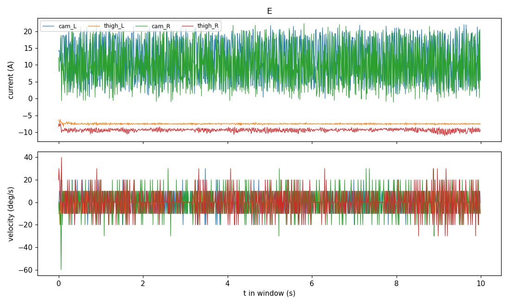
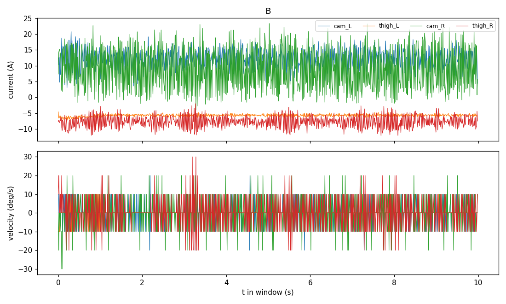
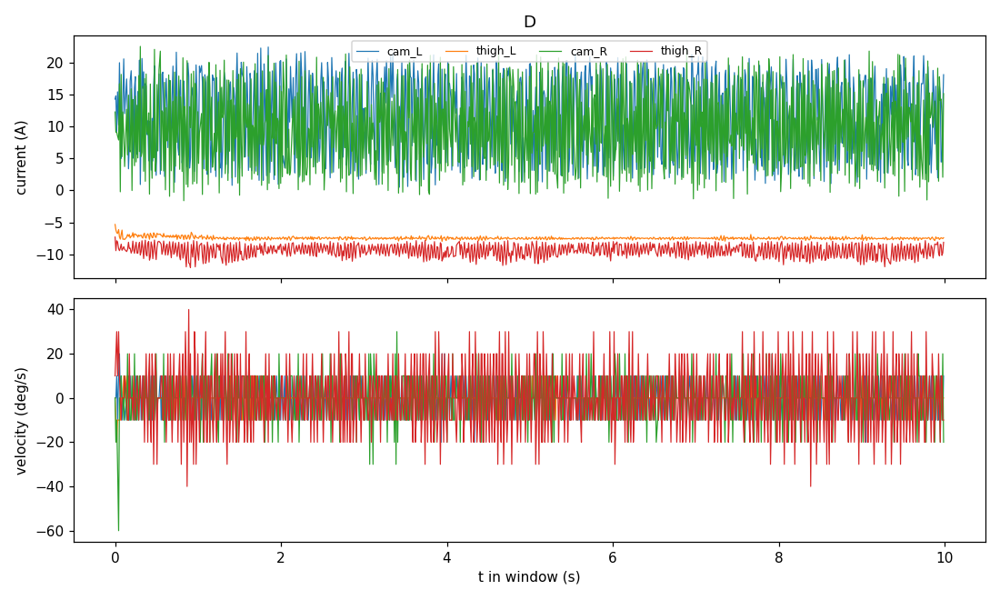
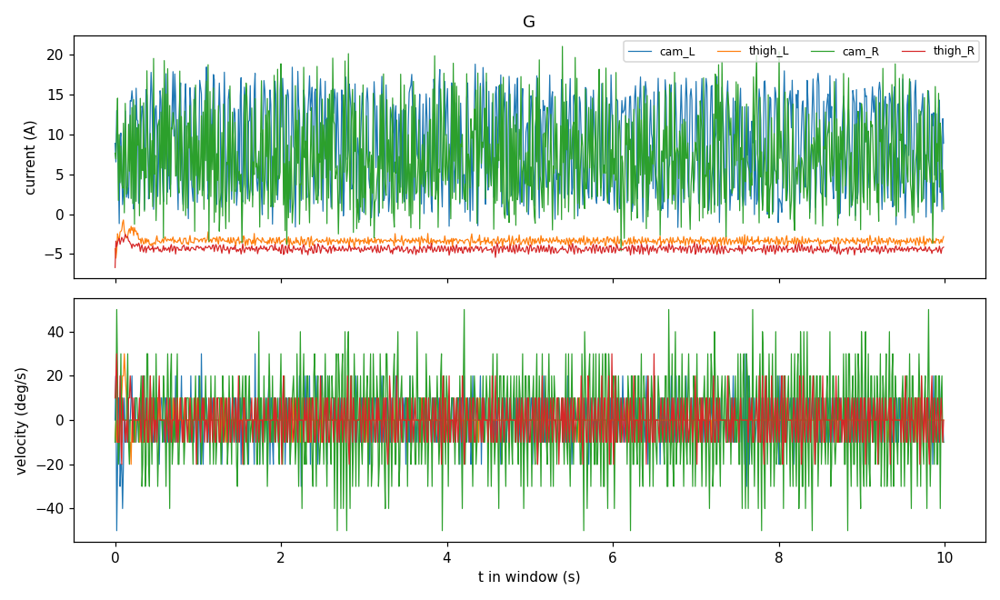
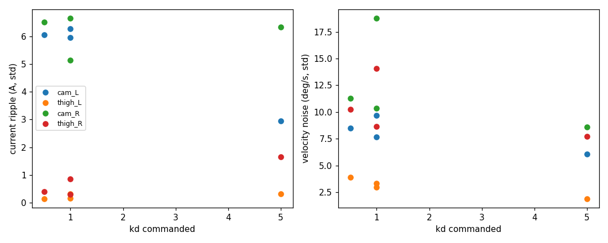

# Kd validation — run analysis

Window: ticks with the full frozen frame (or from 0.5 s for a policy run). 100 Hz log: only the folded trace of the whistle is visible here.

| run | frozen | s | Hz | late | pitch mean / span (deg) | fight L / R | exit |
|---|---|---|---|---|---|---|---|
| E | yes | 9.6 | 96 | 196 | -10.9 / 1.1 | 30% / 63% | max run time 10 s reached |
| B | yes | 9.4 | 93 | 284 | -8.0 / 2.0 | 6% / 53% | max run time 10 s reached |
| D | yes | 9.6 | 95 | 191 | -10.3 / 1.7 | 17% / 62% | max run time 10 s reached |
| G | yes | 9.6 | 96 | 211 | -11.4 / 3.6 | 26% / 49% | max run time 10 s reached |

## Noise (leg joints)

**cam_L**

| run | kp_cmd | kd_cmd | I_ripple_A | dI_rms_A | v_noise_dps | v_flip | f_peak_Hz | hf_frac | temp_max |
|---|---|---|---|---|---|---|---|---|---|
| E | 200.00 | 0.50 | 6.06 | 7.92 | 8.49 | 0.32 | 20.31 | 0.66 | 47.00 |
| B | 200.00 | 5.00 | 2.95 | 4.03 | 6.05 | 0.17 | 20.31 | 0.72 | 52.00 |
| D | 200.00 | 1.00 | 6.28 | 7.84 | 7.65 | 0.24 | 20.31 | 0.61 | 57.00 |
| G | 100.00 | 1.00 | 5.95 | 6.30 | 9.69 | 0.26 | 15.62 | 0.26 | 55.00 |

**thigh_L**

| run | kp_cmd | kd_cmd | I_ripple_A | dI_rms_A | v_noise_dps | v_flip | f_peak_Hz | hf_frac | temp_max |
|---|---|---|---|---|---|---|---|---|---|
| E | 200.00 | 0.50 | 0.15 | 0.24 | 3.88 | 0.06 | 21.88 | 0.84 | 42.00 |
| B | 200.00 | 5.00 | 0.32 | 0.51 | 1.90 | 0.02 | 28.12 | 0.86 | 44.00 |
| D | 200.00 | 1.00 | 0.16 | 0.26 | 2.98 | 0.04 | 26.56 | 0.88 | 45.00 |
| G | 100.00 | 1.00 | 0.31 | 0.48 | 3.34 | 0.04 | 29.69 | 0.78 | 42.00 |

**cam_R**

| run | kp_cmd | kd_cmd | I_ripple_A | dI_rms_A | v_noise_dps | v_flip | f_peak_Hz | hf_frac | temp_max |
|---|---|---|---|---|---|---|---|---|---|
| E | 200.00 | 0.50 | 6.51 | 11.56 | 11.28 | 0.37 | 42.19 | 0.93 | 47.00 |
| B | 200.00 | 5.00 | 6.33 | 10.42 | 8.58 | 0.28 | 34.38 | 0.88 | 51.00 |
| D | 200.00 | 1.00 | 6.66 | 11.71 | 10.35 | 0.38 | 42.19 | 0.94 | 56.00 |
| G | 100.00 | 1.00 | 5.13 | 9.06 | 18.78 | 0.37 | 50.00 | 0.85 | 54.00 |

**thigh_R**

| run | kp_cmd | kd_cmd | I_ripple_A | dI_rms_A | v_noise_dps | v_flip | f_peak_Hz | hf_frac | temp_max |
|---|---|---|---|---|---|---|---|---|---|
| E | 200.00 | 0.50 | 0.39 | 0.58 | 10.26 | 0.26 | 25.00 | 0.79 | 51.00 |
| B | 200.00 | 5.00 | 1.65 | 2.69 | 7.71 | 0.20 | 28.12 | 0.87 | 55.00 |
| D | 200.00 | 1.00 | 0.85 | 1.36 | 14.04 | 0.38 | 26.56 | 0.87 | 59.00 |
| G | 100.00 | 1.00 | 0.29 | 0.45 | 8.63 | 0.22 | 25.00 | 0.82 | 52.00 |

## Stiffness and damping actually obtained (leg joints)

**cam_L**

| run | kp_cmd | kp_eff | kp_static | kd_cmd | kd_eff | R2 | law_R2 | err_deg | tau_mean |
|---|---|---|---|---|---|---|---|---|---|
| E | 200.00 | 8055.67 | 338.56 | 0.50 | -42.96 | 0.23 | 0.01 | 3.68 | 21.73 |
| B | 200.00 | 547.40 | 355.05 | 5.00 | -7.29 | 0.01 | -0.03 | 3.61 | 22.38 |
| D | 200.00 | 7418.92 | 339.75 | 1.00 | -39.76 | 0.20 | 0.01 | 3.68 | 21.80 |
| G | 100.00 | 138.90 | 169.35 | 1.00 | -13.70 | 0.05 | -0.01 | 5.54 | 16.38 |

**thigh_L**

| run | kp_cmd | kp_eff | kp_static | kd_cmd | kd_eff | R2 | law_R2 | err_deg | tau_mean |
|---|---|---|---|---|---|---|---|---|---|
| E | 200.00 | 165.14 | 381.66 | 0.50 | -0.25 | 0.12 | 0.08 | 2.09 | 13.94 |
| B | 200.00 | 321.55 | 377.92 | 5.00 | 0.57 | 0.24 | 0.18 | 1.60 | 10.57 |
| D | 200.00 | 310.07 | 380.43 | 1.00 | -0.63 | 0.32 | 0.25 | 2.08 | 13.82 |
| G | 100.00 | 124.16 | 189.61 | 1.00 | 1.41 | 0.18 | 0.17 | 1.87 | 6.19 |

**cam_R**

| run | kp_cmd | kp_eff | kp_static | kd_cmd | kd_eff | R2 | law_R2 | err_deg | tau_mean |
|---|---|---|---|---|---|---|---|---|---|
| E | 200.00 | -113.71 | 361.80 | 0.50 | -33.57 | 0.32 | -0.03 | -2.91 | -18.40 |
| B | 200.00 | 399.62 | 341.38 | 5.00 | -30.07 | 0.13 | -0.06 | -2.76 | -16.43 |
| D | 200.00 | -176.41 | 372.54 | 1.00 | -33.91 | 0.27 | -0.03 | -2.84 | -18.46 |
| G | 100.00 | 104.21 | 161.88 | 1.00 | 1.71 | 0.01 | 0.01 | -4.70 | -13.29 |

**thigh_R**

| run | kp_cmd | kp_eff | kp_static | kd_cmd | kd_eff | R2 | law_R2 | err_deg | tau_mean |
|---|---|---|---|---|---|---|---|---|---|
| E | 200.00 | 406.29 | 378.19 | 0.50 | 0.03 | 0.74 | 0.58 | -2.63 | -17.39 |
| B | 200.00 | 1216.92 | 381.87 | 5.00 | -2.69 | 0.22 | 0.06 | -2.14 | -14.27 |
| D | 200.00 | 631.64 | 377.99 | 1.00 | -0.67 | 0.60 | 0.37 | -2.65 | -17.46 |
| G | 100.00 | 158.76 | 189.87 | 1.00 | 0.97 | 0.38 | 0.35 | -2.44 | -8.07 |

## Hip roll

**hip_roll_L**

| run | kp_cmd | kd_cmd | I_ripple_A | v_noise_dps | err_deg |
|---|---|---|---|---|---|
| E | 120.00 | 4.00 | 0.12 | 4.32 | -1.00 |
| B | 120.00 | 4.00 | 0.08 | 0.42 | -0.98 |
| D | 120.00 | 4.00 | 0.13 | 0.74 | -0.98 |
| G | 120.00 | 4.00 | 0.15 | 4.45 | -1.05 |

**hip_roll_R**

| run | kp_cmd | kd_cmd | I_ripple_A | v_noise_dps | err_deg |
|---|---|---|---|---|---|
| E | 120.00 | 4.00 | 0.10 | 0.83 | 0.80 |
| B | 120.00 | 4.00 | 0.12 | 1.02 | 0.78 |
| D | 120.00 | 4.00 | 0.11 | 0.86 | 0.78 |
| G | 120.00 | 4.00 | 0.11 | 1.49 | 0.68 |

## Figures

